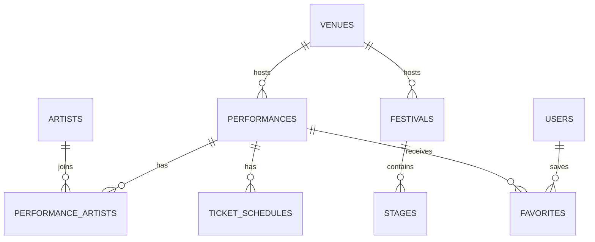

# Oracle 데이터베이스 설계



| 테이블 | 기본 키 | 외래 키 | 추가 규칙 |
| --- | --- | --- | --- |
| `USERS` | `USER_ID` | | 이메일은 앞뒤 공백과 대소문자를 무시해 중복을 막습니다. 비밀번호는 해시만 저장합니다. |
| `VENUES` | `VENUE_ID` | | 지도 검색에 쓰는 지역, 주소와 선택 입력인 위도·경도를 저장합니다. 좌표는 둘 다 입력하거나 둘 다 비워 둡니다. |
| `ARTISTS` | `ARTIST_ID` | | 이름이 같은 서로 다른 아티스트를 저장할 수 있습니다. |
| `PERFORMANCES` | `PERFORMANCE_ID` | `VENUE_ID` | 공연장과 시작 시각이 필수입니다. 종료 시각을 입력하면 시작 이후여야 합니다. |
| `PERFORMANCE_ARTISTS` | `PERFORMANCE_ID`, `ARTIST_ID` | 두 열 모두 | 한 공연에 여러 아티스트가 참여할 수 있고, 같은 공연에 같은 아티스트를 중복 등록할 수 없습니다. |
| `FESTIVALS` | `FESTIVAL_ID` | `VENUE_ID` | 페스티벌의 시작과 종료 시각이 모두 필요합니다. |
| `STAGES` | `STAGE_ID` | `FESTIVAL_ID` | 무대 이름은 페스티벌 안에서 고유합니다. 무대별 아티스트 일정은 이슈 #17에서 추가합니다. |
| `FAVORITES` | `USER_ID`, `PERFORMANCE_ID` | 두 열 모두 | 사용자와 공연의 조합이 고유합니다. 사용자 또는 공연을 삭제하면 연결된 즐겨찾기도 삭제됩니다. |
| `TICKET_SCHEDULES` | `TICKET_SCHEDULE_ID` | `PERFORMANCE_ID` | 선예매(`PRESALE`), 일반예매(`GENERAL`), 추가예매(`ADDITIONAL`)를 저장합니다. 같은 공연·유형·시작 시각의 중복은 허용하지 않습니다. 기존 일정을 변경할 때는 `TICKET_SCHEDULE_ID`로 갱신합니다. |

공연을 삭제하면 출연 관계와 예매 일정도 함께 삭제됩니다. 공연장, 아티스트, 페스티벌을 참조하는 행이 남아 있으면 해당 원본 행의 삭제를 제한합니다.

숫자 기본 키가 있는 테이블에는 삽입할 때 `TICKETHELPER_SEQ.NEXTVAL`을 전달합니다. 날짜와 시각은 `TIMESTAMP(6)`에 UTC로 저장하고 화면에 표시할 때 현지 시간으로 변환합니다. 예를 들어 한국 시간 `2026-12-01 19:00`은 UTC `2026-12-01 10:00`으로 저장합니다.

기본 키와 고유 제약에 쓰이는 인덱스에 더해, 지역별 공연장 조회와 공연장·시작 시각별 공연 및 페스티벌 조회에 인덱스를 둡니다. 아티스트와 공연을 역방향으로 조회하는 연결 테이블에도 인덱스를 둡니다.

## 스키마 생성

Oracle XE 11.2 이상에서 `CREATE TABLE`, `CREATE SEQUENCE` 권한과 테이블스페이스 할당량이 있는 빈 개발 스키마를 사용합니다. 저장소 루트에서 SQL*Plus로 해당 계정에 접속한 뒤 실행합니다.

```sql
@database/schema.sql

SELECT table_name FROM user_tables ORDER BY table_name;
```

스크립트는 최초 설치에 한 번 실행합니다. Oracle의 DDL은 자동 커밋되므로 실행 도중 오류가 나면 이미 만들어진 객체를 확인한 뒤 재시도합니다. [Oracle 11g 시퀀스 문서](https://docs.oracle.com/html/E26088_01/statements_6015.htm)
